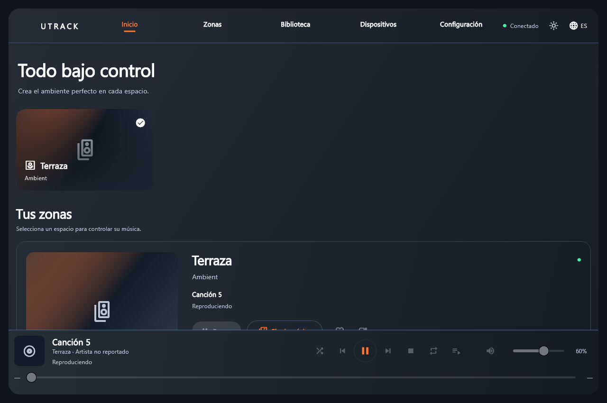
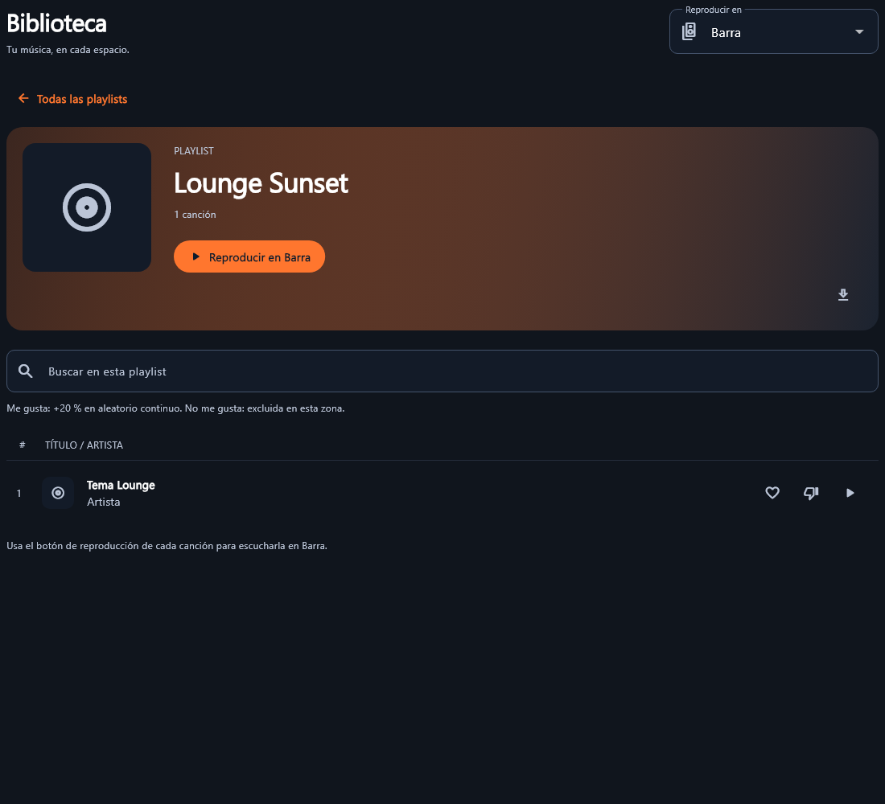

# Utrack Desktop

Interfaz Flutter para el motor local de audio. En producción muestra las zonas y los estados reportados por el motor, sin habitaciones, canciones, dispositivos ni métricas de ejemplo. El plano y la fotografía de equipo son ilustrativos.

La versión 1.1.2 reduce las reconstrucciones de pantalla durante la reproducción, conserva los catálogos sin cambios y muestra las canciones en páginas de 30 filas. En Windows utiliza un control de volumen/posición sin OverlayPortal y separa los nodos accesibles de las acciones para evitar los errores AXTree asociados a sliders y tooltips de Flutter. Conserva navegación por teclado y lector de pantalla.

## Versiones y compatibilidad

- La versión de Desktop se declara en [pubspec.yaml](pubspec.yaml).
- La versión exacta del [motor Go](https://github.com/3mm404/music-engine) requerida por esta rama se declara en [windows/engine/VERSION](windows/engine/VERSION). El [script de empaquetado](build-windows.ps1) comprueba el binario antes de construir Desktop. Si usas un binario de otro checkout, compara primero `engine.exe version` con ese archivo.

En el estado revisado, este repositorio solicita Engine **0.8.11** y el [checkout público del motor en la revisión b220eaa](https://github.com/3mm404/music-engine/blob/b220eaaadb3c725da017841462ab2e0b9641a40c/cmd/agent/main.go#L22) devuelve **0.8.9**. Para empaquetar esta rama de Desktop, proporciona el binario compatible o un checkout del motor que compile la versión requerida.

El motor remuestrea MP3 en memoria y reserva los canales ASIO configurados al inicio para agregar zonas sin cambiar el formato PCM activo.

## Uso de producción en Windows

1. Ejecutar el paquete completo, con `engine.exe` junto a la aplicación.
2. Abrir Ajustes, ingresar servidor HTTPS y token, elegir la salida y guardar.
3. Iniciar motor. La conexión se confirma mediante sincronización, heartbeat y estados recientes.
4. Las zonas aparecen cuando el servidor las entrega al motor.

La aplicación permite configurar, iniciar y detener el motor, controlar la reproducción y ajustar el volumen local por zona. Consulta [el alcance del volumen local](docs/VOLUMEN_DESKTOP.md) para conocer su duración y relación con la configuración del servidor.

```sh
flutter analyze
flutter test
flutter build windows --release --dart-define=UTRACK_TEST=false
```

El empaquetado necesita `windows/engine/engine.exe`. Salida: `build/windows/x64/runner/Release`; distribuir toda la carpeta.

## Documentación

| Documento | Contenido |
| --- | --- |
| [Agregar APIs y funciones](docs/AGREGAR_APIS_Y_FUNCIONES.md) | Registros centrales, paneles adicionales y flujo de integración |
| [Conexiones Desktop y APIs pendientes](docs/CONEXIONES_DESKTOP_Y_APIS_PENDIENTES.md) | Funciones conectadas, flujo y archivos de backend/Go/Flutter |
| [Producción](docs/PRODUCCION.md) | Configuración, datos disponibles y límites comprobados |
| [Arquitectura](docs/ARQUITECTURA.md) | Estructura y responsabilidades |
| [Integración](docs/INTEGRACION.md) | Flujo implementado y extensiones pendientes del protocolo |
| [Mantenimiento](docs/MANTENIMIENTO.md) | Compilación, actualizaciones y distribución |
| [Plan de trabajo](docs/ROADMAP.md) | Próximas entregas y responsables |
| [Registro](DESARROLLO_UI_POR_ETAPAS.md) | Historial de etapas y decisiones |

## Demostración explícita

Estas capturas de desarrollo muestran el panel de zonas y el detalle de una lista con datos de ejemplo.





```sh
flutter run -d chrome --dart-define=UTRACK_TEST=true
```

Solo esa bandera habilita el simulador. Web sin ella informa que el motor local requiere escritorio; no cambia silenciosamente a datos de ejemplo. macOS necesita preparar y validar su motor nativo antes de uso productivo.
