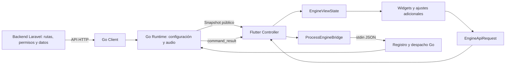

# Espacio para nuevas APIs, funciones y ajustes

## 1. Dónde empezar

Hay dos tipos de conexión: las APIs HTTP del backend que consume Go, y las operaciones locales que Flutter envía al proceso Go por stdin. Cada una tiene un registro central. Agregar una entrada a un registro no implementa por sí solo una función: también requiere productor o handler, modelo y UI.

| Necesito agregar… | Punto de entrada |
| --- | --- |
| Ruta HTTP que consume el motor | `music-engine/internal/control/engine_api_routes.go` |
| Llamada HTTP, autenticación y respuesta | `music-engine/internal/control/client.go` |
| Comando local admitido por Go | `music-engine/internal/control/desktop_operations.go` |
| Parámetros/eventos JSON del puente local | `music-engine/internal/control/desktop_protocol.go` |
| Ejecución/confirmación de comandos locales | `music-engine/internal/control/desktop_commands.go` |
| Implementación del volumen local | `music-engine/internal/control/desktop_volume.go` |
| Datos públicos de zonas enviados a Desktop | `music-engine/internal/control/desktop.go` |
| Operación, nombre y campos admitidos en Flutter | `Utrack_Desktop/lib/integrations/engine_api/engine_api_catalog.dart` |
| Validación y serialización de solicitud Flutter | `Utrack_Desktop/lib/integrations/engine_api/engine_api_request.dart` |
| Coordinación de solicitudes/resultados | `Utrack_Desktop/lib/controllers/engine_controller.dart` |
| Panel de configuración adicional | `Utrack_Desktop/lib/views/settings/engine_extensions_registry.dart` |

En la aplicación, entrar en **Ajustes → Funciones y ajustes adicionales**. Muestra la versión y las capacidades que el motor instalado anuncia realmente. Los futuros paneles se registran en `engineSettingsExtensions`; no es necesario seguir añadiéndolos dentro de `EngineDashboard`.

No se agregaron rutas ficticias ni se habilitaron funciones pendientes. El catálogo actual contiene reproducción, pausa, reanudar, siguiente, anterior y volumen; la lectura de playlist se registra como capacidad de consulta, no como comando ejecutable.

## 2. Flujo de extremo a extremo



Para una acción local ya soportada, no hace falta agregar una API HTTP al backend. Para catálogo, permisos o cambios persistentes, primero se define el contrato del servidor. El motor es quien valida y aplica audio; Flutter muestra intención, espera y resultado observado.

## 3. Cómo agregar un comando local

Ejemplo de trabajo futuro: detener únicamente la zona seleccionada.

1. Revisar el handler real de Go: `internal/control/playback.go` ya conoce `stop` por zona. El comando textual `stop` del pipe significa cerrar el motor completo; no confundir los dos.
2. Registrar la operación JSON en `desktop_operations.go` con el handler correspondiente. Si necesita otros parámetros, declararlos en `desktop_protocol.go` y validarlos antes de ejecutar.
3. Mantener correlación por `request_id`, validación de zona/revisión, resultado aplicado y comportamiento de duplicados en `desktop_commands.go`.
4. Registrar la misma operación en el enum `EngineOperation` de Flutter, con el identificador JSON y nombre de presentación.
5. Si incorpora campos nuevos, declararlos y validarlos en `EngineApiRequest`. Evitar mapas JSON construidos en widgets.
6. Desde el controlador o adaptador enviar `executeEngineRequest(...)`; el controlador gestiona capacidades, espera, timeout y errores.
7. Habilitar el control solo cuando la capacidad exista. El registro de capacidades del motor permite que una app nueva conserve compatibilidad con un motor que aún no tenga esa función.

Ejemplo usando una operación **ya implementada**:

```dart
await controller.executeEngineRequest(
  const EngineApiRequest(
    operation: EngineOperation.pause,
    zoneId: 'ID_REAL_DE_LA_ZONA',
  ),
);
```

La revisión y el identificador de solicitud los completa el controlador. El backend no recibe esa solicitud como una orden administrativa; Go conserva el comportamiento local documentado.

`EngineController.playback(...)` sigue disponible como adaptador de compatibilidad para los widgets existentes, pero ahora delega en el mismo modelo tipado. El punto recomendado para nuevas integraciones es `executeEngineRequest`.

## 4. Cómo agregar un panel de configuración

1. Crear el widget del ajuste en `lib/views/settings/`, separado del registro.
2. Añadir una entrada a `engineSettingsExtensions` con ID estable, builder y, si aplica, `requiredCapability`.
3. El builder recibe `EngineController`. No debe abrir procesos ni leer el token.
4. Si es una configuración persistente del motor, agregar primero almacenamiento y validación en Go `internal/localconfig/`, contrato público en `cmd/agent/desktop.go`, modelo Dart `lib/models/engine_settings.dart` y operación de guardado correspondiente.
5. Si es una operación temporal, usar el modelo de solicitud local y su confirmación. No guardarla como si fuera configuración persistente.

Esquema de registro para un widget futuro —el widget y su capacidad deben implementarse antes—:

```dart
EngineSettingsExtension(
  id: 'identificador_estable',
  requiredCapability: 'capacidad_implementada_en_go',
  builder: (controller) => MiPanel(controller: controller),
),
```

Declarar una capability no concede permisos ni crea soporte en Go. No mostrar switches editables que solo cambien un valor visual.

## 5. Cómo agregar artista, título y otros metadatos

El artista es un dato de lectura, no un comando de reproducción.

1. Backend `UtrackSound`: revisar modelos de canción y `app/Services/EngineAudio.php` / `EngineConfiguration.php`. Definir nombres, nulabilidad y datos permitidos en el contrato.
2. Go: ampliar `Song` en `internal/control/types.go` para leer el dato real.
3. Puente público: definir detalles de canción en `desktop_protocol.go` y rellenarlos en el snapshot `desktop.go`. Conservar la lista actual de IDs si se necesita compatibilidad.
4. Flutter: leerlos en los modelos de `lib/models/`, mapearlos en `EngineViewState` y mostrarlos en `PlayerBar` / Biblioteca.
5. Conservar desconocido cuando falte el dato. No usar un artista inventado ni exponer URLs firmadas, credenciales o secretos de sesión.

No modificar frecuencia, volumen ni comandos para incorporar un nombre de artista. Cada dato debe recorrer únicamente las capas necesarias.

## 6. Cómo agregar una API del backend

Rutas HTTP que Go ya consume están centralizadas en `engine_api_routes.go`. Los métodos de `client.go` las utilizan; `websocket.go` usa el mismo registro para autorización. `Client.request` mantiene las cabeceras, token, sesión, límites y envelope existentes.

Para una nueva API:

1. En Laravel definir ruta, autenticación, autorización por negocio/equipo, request, controlador y formato de respuesta.
2. Revisar `UtrackSound/routes/api.php`, `app/Http/Controllers/EngineController.php`, `app/Services/EngineConfiguration.php` y las policies/modelos del área. No asumir que el token del engine permite administrar el catálogo.
3. Registrar la ruta acordada en Go, implementar un método de Client y su modelo. No concatenar endpoints en el runtime o los widgets.
4. Definir cómo llegará la respuesta a Desktop: evento/snapshot para observaciones, o solicitud correlacionada para consultas nuevas. Una consulta puede necesitar un tipo de respuesta distinto a un comando de audio.
5. En Flutter crear el modelo correspondiente en el espacio de integración y llevar carga, error y resultado al controlador/adaptador.
6. Añadir la vista o el panel mediante el registro de ajustes, si corresponde.

Para un cliente HTTP directo desde Flutter se requeriría otra integración y autenticación de usuario explícita. No reutilizar implícitamente el token protegido de Go ni convertir `EngineOperation` en una lista de URLs administrativas.

## 7. Responsabilidad de cada capa

| Capa | Debe encargarse de |
| --- | --- |
| Backend | Datos persistentes, permisos, catálogo y revisiones |
| Go Client | HTTP y decodificación del contrato backend |
| Go Runtime | Estado autoritativo del proceso y aplicación al audio |
| Registro/protocolo Desktop Go | Operaciones disponibles, datos públicos y despacho |
| Registro/modelo Flutter | Operaciones conocidas, payload y validación de presentación |
| EngineController | Correlación, espera, capacidades, errores y ciclo del proceso |
| EngineViewState | Selección y conversión del estado a datos de pantalla |
| Widget | Mostrar datos y solicitar intenciones; sin HTTP ni stdin |

No añadir un segundo registro manual de capacidades en otra pantalla: derivar las funciones del catálogo y las capacidades anunciadas. No mezclar datos simulados con producción.

## 8. Compatibilidad, entrega y límites

Esta reorganización mantiene nombres JSON, protocolo 1, acciones actuales y motor 0.8.2. No habilita nuevos comandos ni cambia el backend. Los archivos de protocolo/volumen que antes estaban concentrados en `desktop.go` ahora tienen responsabilidades separadas.

Al añadir una capacidad, coordinar Go y Flutter. Al añadir configuración enviada a un motor anterior, recordar que `desktop-configure` rechaza claves desconocidas. Al cambiar un campo de reporte del backend, revisar su validación, no solo el modelo Go.

Antes de una entrega funcional, comprobar: dato ausente, permisos, zona inexistente, revisión antigua, rechazo, reconexión y versiones anteriores. En esta tarea se respeta la instrucción de no ejecutar pruebas: solo compilación Go y análisis estático Dart. Los ZIP anteriores no contienen esta nueva sección; requieren una nueva compilación Flutter para distribuirla.
