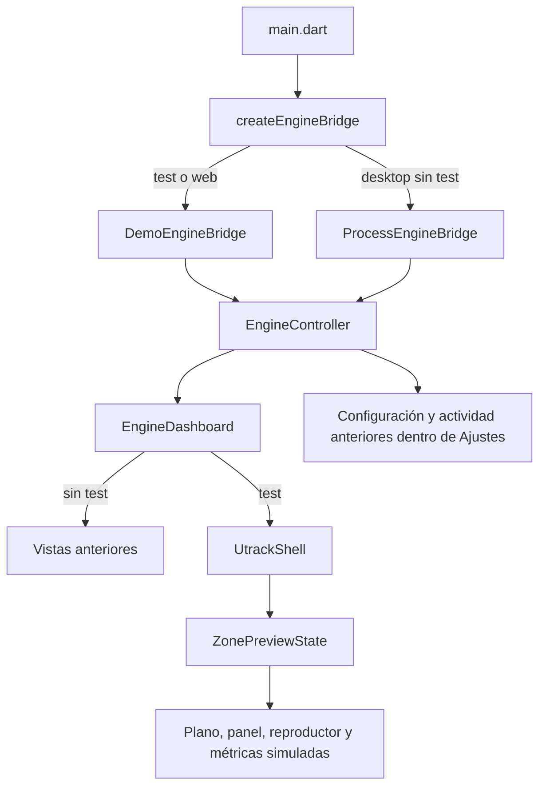

# Arquitectura y responsabilidades

Documento de referencia del código inspeccionado el 19 de octubre de 2026. Distingue **implementado**, **simulado** y **propuesto**. No certifica que el producto esté listo para producción.

## 1. Mapa del repositorio

```text
lib/
  main.dart                         composición inicial y tema
  controllers/
    engine_controller.dart          estado y operaciones del flujo anterior
  models/
    engine_settings.dart            configuración y validación existente
    engine_status.dart              lectura de estados de zona y actividad
  services/
    engine_bridge.dart              interfaz existente de acceso al motor
    process_engine_bridge.dart      proceso local y protocolo JSON
    demo_engine_bridge.dart         simulación del protocolo anterior
    engine_bridge_factory.dart      elección test/plataforma
    platform_engine_bridge*.dart    importación condicional web/escritorio
  views/
    engine_dashboard.dart           selecciona vista test o vista anterior
    overview_view.dart              resumen anterior
    configuration_view.dart         formulario anterior
    activity_view.dart              actividad anterior
    design/                         colores, tipografía, espaciados y tema
    layout/                         shell, sidebar y header nuevos
    widgets/                        plano, paneles, perilla y reproductor
    state/zone_preview_state.dart   simulación de presentación compartida
    contracts/audio_ui_port.dart    frontera tipada propuesta; sin adaptador
assets/images/                      plano y dispositivo generados
windows/                            runner, CMake y empaquetado Windows
macos/                              runner generado; preparación nativa pendiente
web/                                bootstrap, manifest e iconos
build-windows.ps1                    compila Go y después Flutter Windows
pubspec.yaml / pubspec.lock          versión, assets y dependencias
DESARROLLO_UI_POR_ETAPAS.md           bitácora de trabajo
```

`build/`, `.dart_tool/` y los ejecutables generados no son fuentes de la aplicación. No editar registradores de plugins generados para agregar funcionalidad manualmente.

## 2. Las dos rutas que existen hoy



La UI nueva no consume los estados del proceso real: su `ZonePreviewState` conserva sus propios datos. En la vista test, Ajustes aún utiliza el controlador anterior con su bridge simulado. Esta separación debe resolverse antes de conectar producción. El contrato de Etapa 10 no modifica este flujo.

La bandera de compilación `UTRACK_TEST=true` activa el modo test en escritorio; `kIsWeb` lo activa siempre en navegador. El parámetro `MainApp.testMode` es útil para pruebas de widgets, pero no cambia por sí solo el bridge elegido por `main()`.

## 3. Quién es responsable de qué

| Capa/equipo | Responsabilidad | No debe asumir |
| --- | --- | --- |
| Producto/operación | Zonas, reglas de uso, roles, comportamiento ante fallos, plataformas y canales de distribución | Que aprobar una captura equivale a validar audio |
| Flutter UI | Presentación, accesibilidad, selección local, estados de carga/error, intención del usuario | Drivers, reproducción, credenciales o autorización efectiva |
| Estado/presentador futuro | Convertir snapshots a valores de pantalla; enviar comandos tipados; capacidades, pendientes y errores | Fabricar confirmaciones o datos que el motor no reporta |
| Adaptador de integración futuro | Traducir protocolo, IDs, unidades, resultados, orden y versiones | Importar widgets o depender de coordenadas del plano |
| Motor local | Reproducción, cola, sincronización, dispositivos, canales, métricas y recuperación local | Que el servidor remoto tiene acceso a la salida física |
| Backend | Identidad del equipo, autorización, catálogo, asignaciones y configuración remota | Que el estado deseado ya fue aplicado por el motor |
| Distribución/operaciones técnicas | Builds, firmas, instaladores, actualización, rollback, monitoreo | Sobrescribir una instalación mientras el motor escribe datos |
| QA | Regresión UI, protocolo, audio físico, offline, plataformas y actualizaciones | Que pasar pruebas simuladas valida drivers reales |

Son roles sugeridos: una persona puede cubrir varios, pero cada entrega debe tener un responsable identificado.

## 4. Estado y propiedad de recursos

`UtrackShell` crea y libera `ZonePreviewState`. Los widgets reciben esa instancia y escuchan sus cambios. Las variantes independientes de `ZoneMap` y `PlayerBar` crean su propio estado solo cuando no se les inyecta uno. Un componente que recibe una instancia compartida no debe liberarla.

El estado simulado mantiene selección, volumen, pista, progreso, canales y modos por zona; la salida y el motor son globales. Un temporizador avanza la simulación mientras haya reproducción y se cancela al pausar todo o cerrar. Los datos se pierden al destruir el shell. CPU y latencia se calculan con reglas de demostración, no mediante medición.

En el flujo anterior, `EngineDashboard` posee el ciclo de vida del controlador que recibe; cierre/dispose detienen el bridge. Antes de compartir ese controlador entre pantallas hay que revisar esa propiedad para evitar cierres dobles o inesperados.

## 5. Convenciones para continuar

- Mantener colores, tipografía, radios y espaciados en `views/design`.
- Reutilizar componentes de `views/widgets`; no convertir paneles completos en imágenes.
- Mantener datos simulados claramente identificados y sin credenciales reales.
- Usar IDs estables al integrar: los índices de listas y nombres de zona del preview no son identificadores de producción.
- Separar estado observado, estado deseado y selección visual. Habilitada, conectada, reproduciendo y audible no significan lo mismo.
- Reservar verde a estados operativos confirmados. Información desconocida debe presentarse como desconocida, no como cero o éxito.
- Permitir redimensionado y desplazamiento, foco visible, teclado, texto ampliado y movimiento reducido.
- Conservar importaciones condicionales: ningún widget o contrato compartido debe importar `dart:io`.
- No añadir un paquete de estado, red, audio o actualizaciones sin justificarlo y revisar las plataformas.

## 6. Recursos y límites visuales

`zone_floor_plan.png` y `audio_interface.png` son ilustraciones generadas; sus prompts están en el registro de etapas. No representan una instalación ni hardware detectados. La carátula del reproductor está construida con widgets Flutter. Coordenadas normalizadas del plano pertenecen a presentación y deberán poder configurarse por instalación si se admiten planos propios.

La revisión visual incluye cinco tamaños, texto al 150% y movimiento reducido. Hay capturas en `build/previews/`, regenerables mediante el harness. Esto no reemplaza QA en pantallas físicas, lectores de pantalla, distintos DPI, navegadores o un Mac.

## 7. Fronteras pendientes

Biblioteca es un placeholder; falta catálogo, búsqueda de canciones, playlists y sus permisos. El buscador actual solo navega secciones. No hay persistencia de la UI nueva, telemetría de producción, actualizador o adaptador de `AudioUiPort`. La ubicación real de credenciales, política offline y compatibilidad de motores debe acordarse con los equipos respectivos antes de implementarse.
