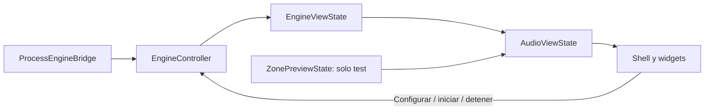

# Arquitectura y responsabilidades

> Actualización 19/10/2026: motor 0.8.1 conecta reproducción y canciones asignadas con Desktop. Las descripciones anteriores de reproducción solo desde servidor quedan sustituidas por [Conexiones Desktop y APIs pendientes](CONEXIONES_DESKTOP_Y_APIS_PENDIENTES.md). Volumen, seek y asignaciones siguen pendientes.

## Estructura

| Ruta | Responsabilidad |
| --- | --- |
| `lib/main.dart` | Composición, bandera de compilación y tema |
| `lib/controllers/engine_controller.dart` | Inspección, configuración, proceso, eventos, conexión y frescura |
| `lib/models/` | Configuración y reportes del motor |
| `lib/services/engine_bridge.dart` | Frontera de operaciones locales |
| `lib/services/process_engine_bridge.dart` | Proceso nativo, stdin y eventos JSON |
| `lib/services/engine_bridge_factory.dart` | Selección explícita test/plataforma |
| `lib/services/demo_engine_bridge.dart` | Simulación del protocolo para test |
| `lib/views/engine_dashboard.dart` | Composición de la vista, controlador y adaptador |
| `lib/views/state/audio_view_state.dart` | Datos y capacidades comunes de presentación |
| `lib/views/state/engine_view_state.dart` | Mapeo de datos reales a la interfaz |
| `lib/views/state/zone_preview_state.dart` | Estado de demostración aislado |
| `lib/views/layout/` | Shell, navegación y cabecera |
| `lib/views/widgets/` | Plano, zona seleccionada, salida, métricas y reproducción |
| `lib/views/design/` | Tema, colores, tipografía y espaciados |
| `lib/views/configuration_view.dart` | Formulario real de servidor, token y salida |
| `lib/views/activity_view.dart` | Actividad del proceso |
| `lib/views/contracts/audio_ui_port.dart` | Propuesta de contrato futuro; no implementado |
| `assets/images/` | Ilustraciones de referencia |
| `test/` | Estado, controlador, UI, capturas y prueba de proceso opt-in |
| `windows/`, `macos/`, `web/` | Runners y empaquetado por plataforma |

## Flujo de datos

Producción muestra únicamente las zonas reportadas. Una selección cambia la vista, no la configuración. Volumen y reproducción son observaciones de solo lectura mientras el protocolo desktop no admita comandos. Los campos ausentes permanecen desconocidos.

## Propiedad y cierre

`EngineDashboard` posee el controlador recibido y el adaptador real. Libera primero el adaptador, que retira su listener, y después el controlador, que cancela su temporizador y cierra el bridge. El shell no libera un estado inyectado. En test crea y libera su propio `ZonePreviewState`.

El cierre solicita terminar el proceso hijo. No equivale a instalar un servicio que siga reproduciendo después de cerrar la UI. No compartir el controlador con otro propietario sin cambiar explícitamente este contrato de vida.

## Responsabilidades futuras

- Flutter: navegación, representación de estados, accesibilidad, capacidades y errores; no inventar datos ni confirmaciones.
- Motor: audio, drivers, routing, caché, credenciales, protocolo y reportes medidos.
- Backend: autoridad de zonas/playlists/comandos, autenticación y políticas de acceso.
- QA: comparar UI con eventos reales, probar audio físico, reconexión, cierre, DPI y dispositivos.
- Release: fijar versiones app/motor/protocolo, empaquetar todos los recursos, firma, instalación y recuperación.

La configuración del motor no debe guardarse como preferencias visuales ni duplicarse en Dart. Mantener tokens fuera de snapshots, documentación y logs de pantalla. La imagen del plano no define habitaciones ni posiciones físicas: estas requerirán configuración persistida propia.

Consultar [Integración](INTEGRACION.md), [Producción](PRODUCCION.md) y [Mantenimiento](MANTENIMIENTO.md) antes de extender capacidades o distribuir una versión.
