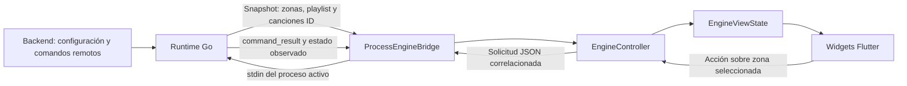

# Conexiones Desktop implementadas y APIs pendientes

> Actualización: motor 0.8.2 conecta volumen local por zona. Ver [Volumen Desktop](VOLUMEN_DESKTOP.md). Las limitaciones de volumen descritas en esta entrega 0.8.1 son históricas; la nueva integración no modifica backend ni persiste el ajuste.

Fecha: 19/10/2026. Proyectos: backend `C:/Develop/ENGINE/UtrackSound`, motor `C:/Develop/ENGINE/music-engine`, Desktop `C:/Develop/ENGINE/Utrack_Desktop`.

## 1. Alcance de esta entrega

Se conectaron únicamente las funciones de reproducción que Go ya ejecutaba y faltaban en Desktop:

| Función | Uso en Desktop |
| --- | --- |
| Pausar | Botón de pausa del reproductor, para la zona seleccionada |
| Reanudar | El mismo botón cuando el reporte indica En pausa |
| Reproducir | El mismo botón cuando la zona está detenida |
| Siguiente / anterior | Botones del reproductor, dentro de la playlist asignada |
| Canción específica | Biblioteca → seleccionar zona → reproducir una canción de su playlist |
| Ver canciones asignadas | Biblioteca: nombre de playlist e IDs de sus canciones |

Las zonas siguen siendo las recibidas del servidor. Seleccionar otra zona solo cambia el objetivo de los controles. No crea ni modifica asignaciones.

No se implementaron catálogo global, edición de zonas, reasignación de playlists, volumen local, seek, aleatorio, repetición ni nuevas métricas. Sus rutas futuras se describen más abajo. No se modificó el backend Laravel.

## 2. Flujo implementado



El control local reutiliza el reproductor y las validaciones del runtime existente. No abre otro reproductor, no introduce URLs desde Flutter y no agrega endpoints HTTP ficticios. Go continúa sincronizando configuración y comandos remotos del servidor.

Las solicitudes locales se procesan en el mismo bucle que los ciclos del servidor. Una orden remota posterior puede cambiar el estado nuevamente. El resultado local confirma ejecución de esa solicitud; no bloquea cambios posteriores desde otro operador.

## 3. Archivos modificados y responsabilidades

### Motor Go

| Archivo, relativo a `music-engine` | Responsabilidad |
| --- | --- |
| `cmd/agent/main.go` | Motor 0.8.1; conecta entrada desktop con runtime observado |
| `cmd/agent/desktop.go` | Anuncia capacidades y decodifica solicitudes JSON desde stdin; conserva `stop` y parada por EOF |
| `internal/control/desktop.go` | Solicitudes/resultados locales, validación de acción, deduplicación y canciones ID en snapshots |
| `internal/control/runtime.go` | Integra el canal local en el bucle del runtime |
| `internal/control/playback.go` | Reutiliza ejecución existente; separa resultados locales de resultados persistidos para el servidor |
| `cmd/agent/desktop_test.go` | Parsing, entradas inválidas y cierre |
| `internal/control/desktop_test.go` | Snapshot público sin URLs firmadas |
| `internal/control/desktop_playback_test.go` | Reproducción local, pausa/reanudación, selección, duplicados y coexistencia con comandos remotos |

### Desktop Flutter

| Archivo, relativo a `Utrack_Desktop` | Responsabilidad |
| --- | --- |
| `lib/services/engine_bridge.dart` | Interfaz opcional `PlaybackEngineBridge` |
| `lib/services/process_engine_bridge.dart` | Envía JSON al stdin del proceso ya iniciado |
| `lib/controllers/engine_controller.dart` | Lee capacidades, correlaciona confirmaciones, limita solicitudes pendientes y muestra errores |
| `lib/models/engine_status.dart` | Lee IDs de canciones asignadas del snapshot público |
| `lib/views/state/audio_view_state.dart` | Capacidad de reproducción separada de volumen/configuración de zona |
| `lib/views/state/engine_view_state.dart` | Relaciona selección visual con acciones reales por ID |
| `lib/views/widgets/player_bar.dart` | Pausa/reanudar/reproducir/siguiente/anterior |
| `lib/views/widgets/assigned_playlist_panel.dart` | Biblioteca de canciones asignadas y selección de zona |
| `lib/views/layout/utrack_shell.dart` | Integra Biblioteca y los avisos del flujo real |
| `test/desktop_playback_test.dart` | Confirmaciones, rechazos, fallo de escritura, cierre y botones conectados |

## 4. Contrato del puente local

El protocolo desktop conserva versión 1 y agrega capacidades opcionales en `desktop-info`: `play`, `pause`, `resume`, `next`, `previous`, `playlist_read`. Una app nueva con motor antiguo no recibe esas capacidades y mantiene los controles deshabilitados. Para usar las funciones nuevas hay que distribuir el motor nuevo junto a Flutter.

Cada solicitud ocupa una línea JSON en stdin. Ejemplo de esquema, con IDs que deben corresponder a la configuración real:

```json
{"request_id":"id-unico","zone_id":"id-zona","config_revision":3,"action":"pause"}
```

Para elegir canción:

```json
{"request_id":"otro-id-unico","zone_id":"id-zona","config_revision":3,"action":"play","song_id":"id-cancion-asignada"}
```

Go responde por stdout:

```json
{"type":"command_result","request_id":"id-unico","result":{"outcome":"succeeded"}}
```

La reproducción que requiere carga puede responder primero `pending` y posteriormente `succeeded` o `failed`. Un fallo incluye código y mensaje en `result.error`. El snapshot de estado se procesa por separado: Flutter no marca una canción como reproducida solo por pulsar el botón.

Reglas actuales:

- La zona debe estar asignada y la revisión coincidir con la aplicada.
- `song_id` solo se acepta con `play` y debe pertenecer a la playlist de esa zona.
- Flutter permite una solicitud pendiente a la vez y espera confirmación hasta 40 segundos. Ante timeout indica revisar el estado; no reintenta automáticamente.
- La solicitud interna tiene vencimiento de 30 segundos para iniciar ejecución. Una descarga iniciada puede tardar más: el timeout visual no equivale a cancelarla.
- El procesamiento puede esperar un ciclo de sincronización de red en curso; no se promete ejecución instantánea.
- Go conserva los resultados locales en memoria durante la sesión para deduplicar por `request_id`, con límite de 4096 solicitudes distintas; después pide reiniciar el motor. No son órdenes durables ni se reenvían tras reinicio.
- Los comandos del servidor mantienen su diario durable. Las órdenes locales no se registran ni confirman como comandos remotos del backend.
- Los cambios de estado sí aparecen en los reportes/heartbeat habituales. Esto no crea un historial administrativo de órdenes locales en Laravel.
- `stop` como línea de texto sigue deteniendo el motor completo. No se expuso un nuevo comando de parada por zona en esta entrega.

## 5. Playlist asignada frente a catálogo global

El backend ya incluye las canciones de cada playlist asignada en su configuración del engine. Antes el evento desktop solo entregaba el nombre de playlist; ahora incluye también `songs`, una lista de IDs.

Se muestran como «Canción ID» porque el contrato actual no contiene título ni artista. No se inventan metadatos. URLs firmadas, token y secretos de sesión permanecen fuera del snapshot desktop.

Biblioteca en esta entrega no significa catálogo completo del negocio. Solo permite consultar y reproducir las canciones asignadas a la zona seleccionada.

## 6. APIs existentes del backend: mapa de conexión

Archivos inspeccionados en `UtrackSound`, sin modificarlos:

| Archivo | Papel |
| --- | --- |
| `routes/api.php` | Rutas del protocolo del engine |
| `app/Http/Controllers/EngineController.php` | Sesión, configuración, comandos, resultados y heartbeat |
| `app/Http/Middleware/AuthenticateEngine.php` | Autenticación del equipo |
| `app/Services/EngineConfiguration.php` | Construcción de snapshots y encolado de órdenes |
| `app/Services/EngineAudio.php` | Metadatos técnicos y autorización de audio |
| `app/Models/Zone.php`, `Playlist.php`, `PlaylistSong.php`, `EngineCommand.php` | Datos y relaciones |
| `app/Policies/ZonePolicy.php`, `PlaylistPolicy.php`, `EnginePolicy.php` | Políticas existentes a revisar para APIs administrativas |
| `app/Observers/EngineConfigurationObserver.php`, `app/Events/EngineChanged.php` | Cambios de configuración y notificaciones |

Rutas verificadas bajo `/api/v1/engine`:

- `POST /sessions`: abre sesión del equipo.
- `GET /config`: configuración y zonas asignadas, con playlist/canciones.
- `GET /commands`: el motor consume órdenes ya encoladas.
- `PUT /commands/{commandId}/result`: confirma resultado de una orden del servidor.
- `POST /heartbeat`: reporta estado observado.
- `POST /broadcasting/auth`: autorización del canal de notificaciones.

En Go estas llamadas están en `internal/control/client.go`; sus modelos están en `internal/control/types.go`. `runtime.go` aplica configuración y consume órdenes. `websocket.go` recibe avisos para volver a sincronizar.

**No existe en esas rutas verificadas un POST administrativo para que Flutter cree órdenes o edite playlists/zonas.** El token del engine no debe suponerse equivalente a una sesión administrativa de usuario. No conectar nuevas pantallas a rutas inventadas ni ampliar permisos implícitamente.

## 7. Trabajo futuro: dónde insertar cada conexión

### A. Ver el catálogo completo de playlists

**Backend:** definir contrato, autenticación, permisos de negocio, paginación y metadatos. Declarar rutas administrativas en `routes/api.php`, con controlador/recurso/request siguiendo las convenciones de Laravel y consultando modelos/policies existentes. Los nombres de nuevos archivos y rutas se decidirán al implementar; no están creados por esta entrega.

**Go:** si el catálogo llegará a Desktop a través del motor, añadir métodos en `internal/control/client.go`, modelos en `types.go` y una solicitud/respuesta pública en el puente desktop. Transportar datos de presentación sin URLs privadas ni secretos.

**Flutter:** ampliar la interfaz de servicio, el controlador y los modelos; agregar estado de carga/error/paginación al adaptador y una vista de catálogo. Mantenerlo separado de la playlist actualmente asignada.

Si se decide que Flutter consuma directamente la API administrativa, crear un servicio HTTP y una autenticación de usuario propios. No copiar el token protegido del motor a los widgets. Elegir uno de los dos flujos antes de implementar.

### B. Crear/editar zonas o asignar otra playlist

**Backend:** validar negocio, propiedad del equipo, playlist y permisos; aplicar cambios mediante el flujo de configuración existente. Revisar `EngineConfiguration.php`, modelos, policies, observer y evento de cambio para conservar revisiones y notificaciones.

**Go:** recibir la nueva configuración por `GET /config`, validarla y aplicarla con `Runtime.apply` / `applyAudio`; emitir snapshot actualizado. No modificar solo la lista visual.

**Flutter:** enviar la intención mediante el servicio administrativo acordado, mostrar solicitud pendiente y confirmar el resultado con la configuración recibida. La selección local de otra zona ya existe y no necesita esta API.

### C. Volumen, canales o salida por zona

No conectar un slider a un éxito local. Definir primero si modifica configuración persistida en el servidor o una propiedad temporal del runtime. Revisar validación de configuración/backend, `runtime.go`, `playback.go`, puente, controlador y capacidad específica en Flutter. Conservar las reglas de routing ASIO/Oto. Estos controles no se habilitaron en esta entrega.

### D. Seek, aleatorio y repetición

No están incluidos en las acciones conectadas. Requieren semántica y soporte de reproducción real, contrato de comandos y confirmación. Añadir capacidades independientes; no reutilizar la capacidad de reproducción para habilitar todo el reproductor.

### E. Títulos, artistas, duración, carátulas y métricas

Definir origen y campos opcionales. Para metadatos: backend y `EngineAudio.php`/snapshot según corresponda, modelos Go, snapshot público, modelos Dart y widgets. Para mediciones: productor real en Go y unidades explícitas. Si falta el dato, mantener «No reportado». No rellenar con ejemplos en producción.

## 8. Actualizar y probar

Se compilaron juntos motor 0.8.1 y Flutter de producción. No basta con copiar código fuente Go: el archivo que debe empaquetar Flutter es `windows/engine/engine.exe`.

Orden de desarrollo:

1. Definir contrato y propietario del dato/acción.
2. Implementar y probar backend cuando la función lo requiera.
3. Implementar Go y sus pruebas de protocolo/audio.
4. Compilar el nuevo motor para el destino.
5. Conectar modelos, servicios, controlador, adaptador y widgets Flutter.
6. Probar errores, versiones antiguas, ausencia de datos y desconexión.
7. Compilar Flutter y distribuir el paquete completo con el motor compatible.

Validación de esta entrega: suite Go completa correcta; análisis Dart sin incidencias; 40 pruebas Flutter correctas y la prueba opt-in de proceso ejecutada aparte con éxito. Las pruebas de reproducción Go utilizan audio sintético y salida de prueba; no validan tu hardware. Sigue pendiente comprobar autenticación, audio físico y acciones con la instalación real del usuario. No se ingresó el token del servidor operativo.

Guía complementaria: [Flujo de desarrollo Flutter y Go](FLUJO_DESARROLLO_FLUTTER_GO.md).
