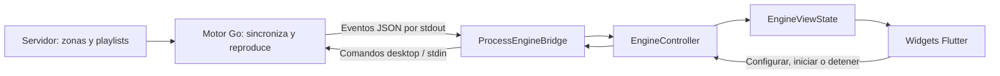

# Guía de desarrollo: actualizar Flutter y el motor Go

> Actualización 19/10/2026: motor 0.8.1 conecta reproducción y canciones asignadas con Desktop. Las descripciones anteriores de reproducción solo desde servidor quedan sustituidas por [Conexiones Desktop y APIs pendientes](CONEXIONES_DESKTOP_Y_APIS_PENDIENTES.md). Volumen, seek y asignaciones siguen pendientes.

Esta guía explica cómo agregar parámetros, mantener compatibles los dos proyectos y preparar una entrega. No ejecuta cambios ni instala un actualizador.

## 1. Proyectos y flujo actual

- Flutter: `C:/Develop/ENGINE/Utrack_Desktop`.
- Motor Go: `C:/Develop/ENGINE/music-engine`.
- Binario que Flutter empaqueta en Windows: `C:/Develop/ENGINE/Utrack_Desktop/windows/engine/engine.exe`.

Modificar el código Go no actualiza automáticamente ese ejecutable. Hay que recompilarlo y después volver a compilar Flutter para que el paquete incluya la nueva versión.



La interfaz representa lo observado. El motor controla audio, drivers, routing y almacenamiento de credenciales. El servidor administra las zonas y las operaciones remotas. No crear una segunda configuración de zonas dentro de Flutter.

## 2. Antes de agregar un parámetro

Definir estas preguntas en la tarea:

| Pregunta | Ejemplo |
| --- | --- |
| ¿Quién produce el valor? | Motor: posición de reproducción medida |
| ¿Es observado o editable? | Observado; no permite seek por sí mismo |
| ¿Dónde aplica? | Por zona |
| ¿Nombre y unidad? | `position_ms`, entero en milisegundos |
| ¿Qué significa ausencia? | `null`: desconocido; `0`: inicio real de reproducción |
| ¿Cómo se actualiza? | En cada reporte, sin reloj ficticio en Flutter |
| ¿Necesita persistencia? | No para una posición observada; sí podría necesitarla una preferencia |
| ¿Qué ocurre con versiones antiguas? | UI muestra desconocido cuando falta el campo |

Distinguir tres trabajos: mostrar un dato, editar una configuración o ejecutar una acción. Agregar un campo JSON no implementa una operación de audio.

## 3. Agregar un dato que solo se muestra

Recorrer las capas desde el origen hasta la pantalla:

1. **Motor:** obtener el dato real desde el componente que lo conoce.
2. **Reporte:** declarar su campo JSON y rellenarlo; no basta con declarar la estructura.
3. **Modelo Dart:** leerlo como opcional y validar tipo, unidad y límites.
4. **Controlador:** conservarlo dentro del estado observado y notificar actualizaciones.
5. **Adaptador visual:** mapearlo a `AudioViewState` / `EngineViewState`.
6. **Widget:** mostrar el valor o un texto de ausencia, con el estado de frescura correspondiente.
7. **Pruebas:** cubrir valor presente, ausente, cero válido, dato inválido y desconexión.

Archivos que normalmente intervienen:

| Capa | Archivo |
| --- | --- |
| Reportes del motor | `music-engine/internal/control/types.go` |
| Construcción del reporte | `music-engine/internal/control/runtime.go` |
| Datos del reproductor | `music-engine/internal/control/playback.go`, función `audioReport` |
| Envoltorio de eventos desktop | `music-engine/internal/control/desktop.go` |
| Modelo de zonas Flutter | `Utrack_Desktop/lib/models/engine_status.dart` |
| Recepción de eventos | `Utrack_Desktop/lib/controllers/engine_controller.dart` |
| Frontera de presentación | `Utrack_Desktop/lib/views/state/audio_view_state.dart` |
| Mapeo real | `Utrack_Desktop/lib/views/state/engine_view_state.dart` |
| Presentación final | Widget correspondiente en `Utrack_Desktop/lib/views/widgets/` |

No todos los parámetros requieren editar todos los archivos. Por ejemplo, un campo ya leído en Dart solo necesita que el motor lo produzca correctamente y revisar su presentación.

### Ejemplo concreto: posición de reproducción

`position_ms` ya está declarado en el reporte Go y se lee en `ZoneStatus.positionMs`. El adaptador ya lo convierte a segundos para presentación. En el motor inspeccionado, `audioReport` aún no rellena esa posición.

El siguiente trabajo sería obtener la posición real y rellenar ese campo en Go; después probar que llega a Flutter. La duración sigue siendo otro dato pendiente: sin ella no debe representarse una proporción de avance inventada ni habilitarse seek.

Para CPU o latencia, definir primero qué se mide, cómo y en qué ámbito. No deducir latencia de un valor de buffer como si fuera una medición completa.

## 4. Agregar un parámetro editable de configuración

Ejemplos actuales: backend, frecuencia ASIO o tamaño de buffer.

1. Añadir almacenamiento, valor predeterminado y validación en `music-engine/internal/localconfig/config.go` y, si corresponde, su implementación por plataforma.
2. Ampliar `desktopSettings` y su conversión en `music-engine/cmd/agent/desktop.go`: lectura pública y recepción de configuración deben coincidir.
3. Aplicar el parámetro en el componente del motor que realmente lo utiliza. Definir si requiere reiniciar.
4. Ampliar constructor, `fromJson`, `toJson` y `validate` de `Utrack_Desktop/lib/models/engine_settings.dart`.
5. Añadir el campo al formulario `Utrack_Desktop/lib/views/configuration_view.dart`.
6. Guardar mediante `EngineController.save`, volver a inspeccionar y mostrar el resultado real. No guardar un éxito solo en la pantalla.
7. Probar guardado, error, recarga, instalación con configuración anterior y token vacío conservando credencial.

**Compatibilidad importante:** `desktop-configure` usa `DisallowUnknownFields()` en Go. Una app nueva que envíe una clave desconocida a un motor antiguo puede recibir un rechazo. Añadir un campo opcional a un evento no tiene la misma compatibilidad que añadir una clave de configuración enviada por Flutter.

Entregar app y motor compatibles juntos, o implementar una negociación explícita de capacidades antes de enviar campos nuevos. No enviar claves nuevas indiscriminadamente a motores antiguos.

El token permanece bajo responsabilidad del motor. No agregarlo a los modelos de presentación ni a un archivo de preferencias Flutter.

## 5. Agregar una acción: volumen, play/pause o seek

Hoy el proceso `run --desktop` acepta `stop` por stdin. No existe en ese pipe una API local de control de reproducción por zona. Por eso los controles correspondientes están deshabilitados.

Para habilitar una acción:

1. Acordar si la autoridad será el servidor o el equipo local y cómo resolver cambios simultáneos.
2. Diseñar el comando, ID de zona, validación, permisos, identificador de solicitud y resultado aplicado.
3. Implementar y probar el receptor en Go y su efecto real en audio. Si depende del servidor, acordar también su API; no inventar endpoints desde Flutter.
4. Ampliar `lib/services/engine_bridge.dart` y su implementación `process_engine_bridge.dart` con el transporte acordado.
5. Añadir operación, espera y errores en el controlador; exponer capacidad en el estado de presentación.
6. Conectar el control visual únicamente cuando exista soporte. Un resultado de aceptación no sustituye un reporte de aplicación.
7. Probar rechazo, timeout, reintento, desconexión, zona eliminada y modificación concurrente; comprobar el resultado con audio físico.

`AudioViewState.canControlZones` actualmente es una capacidad global. Si se implementa solo volumen, separar capacidades por operación antes de activarlo: no habilitar por accidente todos los demás controles.

`lib/views/contracts/audio_ui_port.dart` conserva una propuesta para una evolución más completa; no es el contrato activo. Revisar qué aporta antes de migrar, sin mantener dos fuentes de estado.

## 6. Ciclo de trabajo recomendado

1. Crear una rama y registrar el comportamiento esperado, las unidades y los errores.
2. Modificar primero el productor real del dato o receptor de la acción en Go.
3. Probar Go y revisar el JSON público sin tokens ni datos sensibles.
4. Actualizar modelos, controlador, adaptador y UI Flutter según lo necesario.
5. Probar Flutter con fixtures representativas, incluyendo ausencia de datos. Los datos de prueba permanecen en tests o en el modo test explícito.
6. Recompilar el motor y colocarlo en `windows/engine/engine.exe`.
7. Ejecutar la app de escritorio sin modo test y comprobar el flujo completo.
8. Compilar release, revisar el paquete y documentar versiones, cambios y límites.

Si cambias solo estilos o layout, normalmente no necesitas modificar ni recompilar Go. Si cambias el contrato o el comportamiento de audio, validar ambos proyectos.

## 7. Comandos de desarrollo en Windows

Ejecutar desde PowerShell con Go, Flutter y herramientas nativas disponibles. El `go.mod` actual declara Go 1.26.0; verificarlo al preparar el entorno. Estos comandos son una guía y no se ejecutan al leer este documento.

### Motor y copia del binario

Detener primero el motor y cerrar cualquier aplicación que use el ejecutable de destino.

```powershell
Set-Location C:/Develop/ENGINE/music-engine
go version
go test ./...
if ($LASTEXITCODE -ne 0) { throw 'Fallaron las pruebas Go' }
go build -trimpath -o C:/Develop/ENGINE/Utrack_Desktop/windows/engine/engine.exe ./cmd/agent
if ($LASTEXITCODE -ne 0) { throw 'Falló la compilación Go' }
```

Las pruebas generales no sustituyen la comprobación de drivers y audio físico. Algunos cambios pueden requerir hardware o configuración específicos.

### Flutter y release

```powershell
Set-Location C:/Develop/ENGINE/Utrack_Desktop
flutter analyze
if ($LASTEXITCODE -ne 0) { throw 'Falló el análisis' }
flutter test
if ($LASTEXITCODE -ne 0) { throw 'Fallaron las pruebas Flutter' }
flutter run -d windows --dart-define=UTRACK_TEST=false
```

Después de comprobar manualmente y cerrar la app:

```powershell
flutter build windows --release --dart-define=UTRACK_TEST=false
if ($LASTEXITCODE -ne 0) { throw 'Falló la compilación Flutter' }
```

La salida está en `C:/Develop/ENGINE/Utrack_Desktop/build/windows/x64/runner/Release`. Entregar la carpeta completa: EXE de Flutter, `engine.exe`, DLL, datos y assets.

El script existente `build-windows.ps1` automatiza compilar Go y después Flutter, pero no ejecuta las pruebas. Revisar su contenido y las banderas antes de usarlo; los pasos explícitos anteriores permiten controlar cada fase.

La prueba opt-in `test/process_engine_bridge_test.dart` verifica guardado protegido e inicio/parada con almacenamiento temporal. Ver MANTENIMIENTO.md para ejecutarla. No demuestra reproducción contra el servidor operativo.

## 8. Versiones, compatibilidad y actualizaciones

Mantener tres referencias separadas:

| Referencia | Ubicación actual | Uso |
| --- | --- | --- |
| Versión de app | `Utrack_Desktop/pubspec.yaml` | Identificar la entrega Flutter |
| Versión del motor | `music-engine/cmd/agent/main.go` | Identificar el binario Go |
| Protocolo desktop | `music-engine/cmd/agent/desktop.go` y validación en `EngineController` | Compatibilidad de mensajes |

Actualmente se utiliza motor 0.8.0 y protocolo 1. Cambiar una etiqueta de versión no implementa compatibilidad. Si rompes el protocolo, actualizar también el cliente y su validación; si agregas campos opcionales, conservar lectores tolerantes y probar la combinación admitida.

En cada entrega registrar:

- Versiones y commits de ambos repositorios.
- Campos o comandos agregados y si requieren reinicio.
- Compatibilidad con configuraciones existentes y migraciones necesarias.
- Pruebas realizadas y pendientes, incluyendo servidor/audio físico.
- Paquete completo y procedimiento de retorno a la versión anterior.

No hay actualizador automático implementado. Por ahora la distribución es manual: detener la app/motor, conservar la versión anterior y sustituir el paquete completo. Las credenciales/configuración viven fuera del paquete; no sobrescribirlas ni incluirlas en un ZIP. Antes de cambiar su formato, diseñar migración y recuperación: un binario anterior podría no entender los datos nuevos.

Evitar sustituir solamente `engine.exe` en una instalación operativa sin comprobar compatibilidad. Si se soportan actualizaciones independientes, definir primero una matriz de versiones y pruebas para esas combinaciones.

## 9. Criterio para dar un cambio por terminado

Un parámetro queda integrado cuando el origen lo produce o aplica, el transporte lo entrega, Dart lo interpreta y la UI representa correctamente tanto su valor como su ausencia/error. Una acción exige además confirmación del motor y comprobación de su efecto.

Para producción: no crear habitaciones, canciones, dispositivos ni métricas de ejemplo. Los campos pendientes permanecen preparados y visibles como desconocidos. El plano puede seguir siendo ilustrativo; las zonas corresponden a las recibidas del motor.

Documentos relacionados: [Producción](PRODUCCION.md), [Arquitectura](ARQUITECTURA.md), [Integración](INTEGRACION.md) y [Mantenimiento](MANTENIMIENTO.md).
